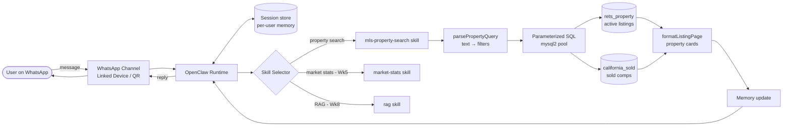

# Week 1 — Architecture Documentation

## 1. End-to-end flow

## 2. Components

| Component | Role in this project | Where |
|---|---|---|
| Channel | Moves messages between WhatsApp and the runtime | `openclaw channels login --channel whatsapp` |
| Runtime | Receives message, loads session, picks skill, returns reply | OpenClaw |
| Skill | Modular capability (search, stats, RAG) | `skills/mls-property-search` |
| Tool | Typed async function a skill calls | `parsePropertyQuery`, `searchActiveListings`, `getSoldComps` |
| Session | Per-user state (city, budget, last results) | Week 4 `UserSession` |
| Memory | Short-term session + long-term vectors | Weeks 4 and 6 |
| Orchestrator | Routes to the right specialist agent | Week 9 |

## 3. Request walkthrough (worked example)

1. User sends: *"3-bedroom condos in Irvine under $1.5M with a pool"*.
2. Channel hands text to the runtime; session for that phone number is loaded.
3. Selector matches the property-search skill (listing intent).
4. `parsePropertyQuery` → `{ city: "Irvine", beds: 3, type: "Condominium", maxPrice: 1500000, pool: "True" }`.
5. `searchActiveListings` runs:
   `SELECT … FROM rets_property WHERE L_Status='Active' AND L_City=? AND L_SystemPrice<=? AND L_Keyword2>=? AND L_Type_=? AND PoolPrivateYN=? ORDER BY L_SystemPrice LIMIT 5 OFFSET 0`
6. Rows → `formatListingPage` → WhatsApp cards (address, price, bd/ba/sqft, DOM, photo count, agent).
7. Session updated (filters + `lastResults`), reply sent. "more" requests page 2.

## 4. Design decisions
- **Parameterized SQL only** — user text never reaches the SQL string (injection-safe). LIMIT/OFFSET are clamped integers.
- **Parser separate from DB layer** — can be tested with no database, and later swapped for an LLM parser.
- **Sold comps anchored to newest `CloseDate`** — the data ends in 2025, so `CURDATE()` windows would be empty.
- **Secrets in `.env`** — never committed.
